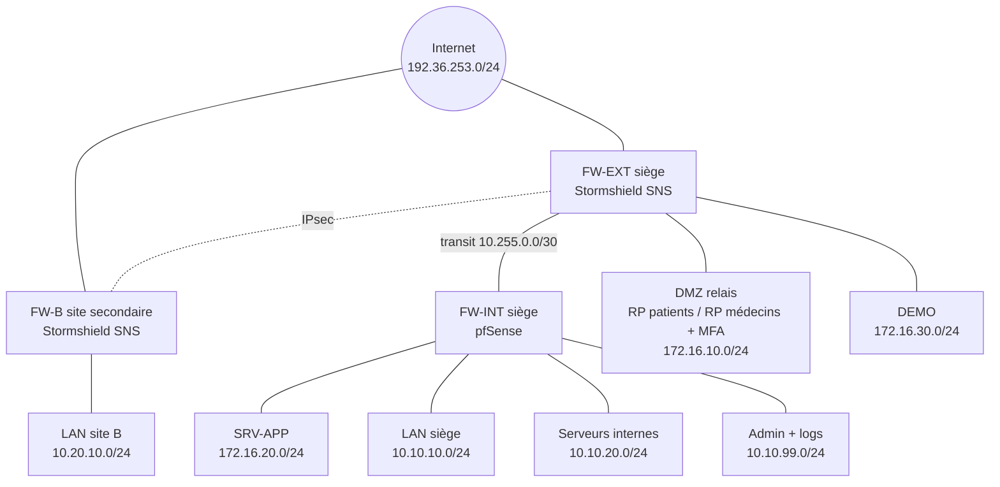

# MediConnect : sécurisation de l'infrastructure réseau

Projet de sécurité des réseaux (EFREI Paris, ING2, cours de S. Benayoune).
Conception et mise en œuvre de l'architecture réseau d'une plateforme de prise de rendez-vous médicaux, en appliquant le guide **ANSSI PA-066** (interconnexion d'un SI à Internet).

> L'application web est considérée comme existante. Le projet porte uniquement sur le réseau : segmentation, DMZ, pare-feux, VPN, identité, administration et journalisation.

## Objectifs

- Interconnexion sécurisée de deux sites (IPsec)
- Portail patients exposé exclusivement en HTTPS
- Espace médecins séparé, en HTTPS avec MFA, sans accès réseau interne
- VPN d'accès distant avec règles basées sur l'identité (support, compta, employés, IT, admins, commerciaux)
- Zone DEMO isolée de la production
- Administration séparée des flux utilisateurs (bastion)
- Contrôle applicatif et journalisation centralisée

## Architecture



Choix clés et références ANSSI :

| Choix | Référence |
|---|---|
| Pare-feux externe et interne distincts, de technologies différentes | R2, R3, R13 |
| Chaînes séparées patients / médecins / VPN / démo | R6 |
| Aucun flux initié de la DMZ vers le SI interne | R7 |
| Rupture protocolaire par reverse proxy + IPS | R8, R9 |
| Pas d'annuaire interne interrogé depuis la DMZ | R10 |
| Administration depuis une zone dédiée | R16 |
| Routage statique, DROP silencieux côté Internet | R19, R20 |

Détails : [docs/01-cadrage.md](docs/01-cadrage.md)

## Environnement de lab

VirtualBox sur un hôte de 16 Go de RAM : Stormshield SNS EVA (x2), pfSense, serveurs Debian 13, clients Alpine et Kali.

## Avancement

Voir [docs/journal.md](docs/journal.md).

| Phase | Statut |
|---|---|
| 1. Cadrage (besoins, zones, adressage, matrice des flux) | Fait |
| 2. Socle lab (VM, réseaux, interfaces, routage) | Fait pour le siège (site B à faire) |
| 3. DMZ, reverse proxies, zone DEMO | Fait : deux services publiés, filtrage restrictif, DEMO isolée et réservée au VPN (relais sortant à faire) |
| 4. VPN IPsec site à site | Fait : tunnel site B vers zone SERVEURS, applications internes atteintes en HTTPS |
| 5. VPN SSL, annuaire, règles par identité, MFA | En cours : VPN SSL et filtrage par groupe validés pour les commerciaux, MFA à faire |
| 6. Administration sécurisée (bastion) | À faire |
| 7. Contrôle applicatif et journalisation | À faire |
| 8. Tests, rapport, vidéo | À faire |

## Structure du dépôt

```
docs/        cadrage, journal de bord, choix d'architecture
lab/         scripts de construction de l'environnement VirtualBox
configs/     exports de configuration nettoyés (sans secrets)
tests/       scénarios de test et résultats
diagrams/    schémas d'architecture
rapport/     rapport final
```

## Sécurité du dépôt

Aucun secret n'est versionné : pas de mots de passe, clés privées, certificats, profils VPN ni sauvegardes brutes de pare-feu. Voir [configs/README.md](configs/README.md).

## Auteur

Sam Dossou, EFREI Paris
